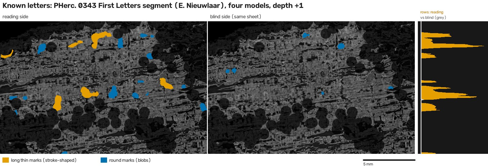
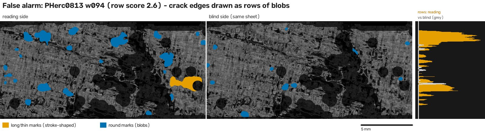
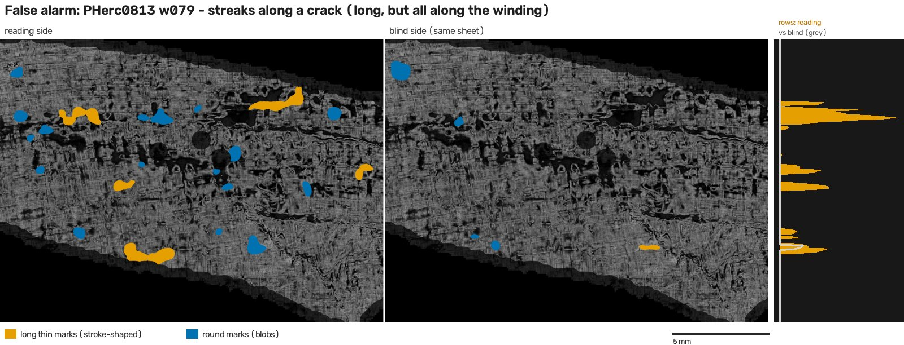
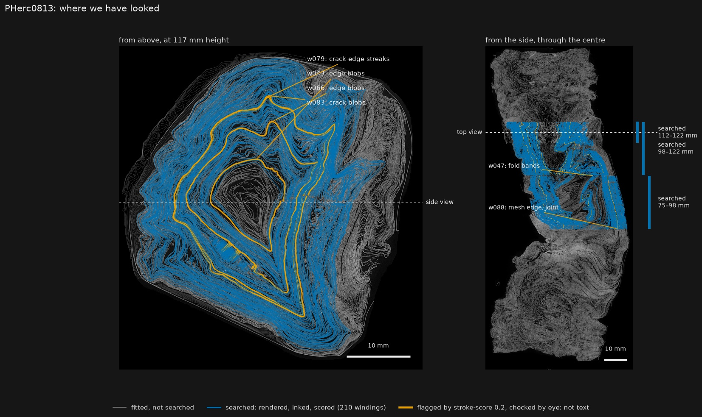
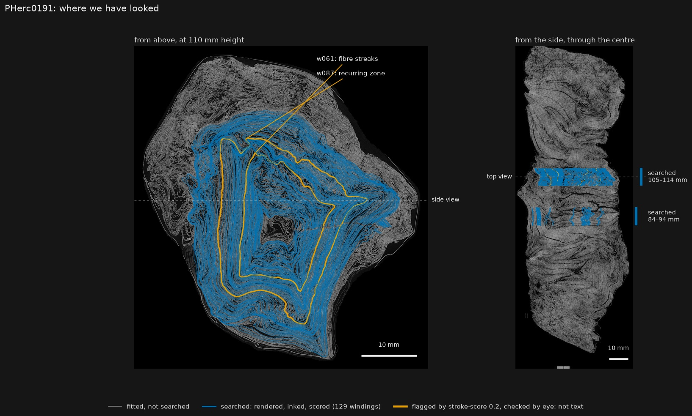

# stroke-score 0.2: sorting through a 9 µm ink search

**Ted Bienapfl** (GitHub [skuzbucket1](https://github.com/skuzbucket1)) · 14 October 2026 · stroke-score 0.2.2 ·
[code](https://github.com/skuzbucket1/scroll-prize/tree/main/tools/stroke-score) (MIT) ·
[research log](https://skuzbucket1.github.io/scroll-prize/)

For the past few weeks I've been searching eligible scrolls for First Letters; the results here come from PHerc0191 and
PHerc0813. Each winding I flatten gets rendered and inked with several models at a couple of depths, and I look at both
faces of the sheet. That adds up to thousands of images. The ink models light up on cracks and voids almost as readily as on ink, so
I needed a way to sort the pile and find the few images worth a careful look.

stroke-score does that sorting. It ranks every winding, writes review crops so each look is quick, and leaves the
decision to a person. It's in `tools/stroke-score` at github.com/skuzbucket1/scroll-prize (MIT):
`pip install ./tools/stroke-score`. My research log is at skuzbucket1.github.io/scroll-prize.

### What it looks for

Writing has a few habits that damage doesn't:
- Letters are made of strokes, so ink marks are long and thin. Cracks and voids leave round blobs.
- Lines of writing sit one above another at a steady spacing, so ink comes in rows.
- Ink is on one face of the sheet, so the reading side should show more than the blind side.
- Text doesn't repeat at the same spot turn after turn. A crack zone running through the scroll does.

stroke-score measures each of these on the ensemble of whatever ink models you ran, using Erwin Nieuwlaar's
normalisation. It flags a window when it sees rows of strokes, or a clear difference between the two sides of the sheet.



*Erwin Nieuwlaar's PHerc. 0343 letters as the tool sees them. Orange marks are long and thin, the shape of letter
strokes; blue marks are round blobs. Left is the reading side, middle is the blind side of the same sheet, and right
shows how much ink there is at each height. The reading side has two rows of strokes; the blind side has very little.*





*Two false alarms from PHerc0813. w094 has two rows of marks, so it scored high on rows, but the marks are blobs along
crack edges, and the shape check drops it. w079 has long marks, but they all run flat along a crack. The tool still
flags it, and one look at the CT next to it settles the question.*

### Four things that surprised me

**My bands are only a centimetre tall.** I first calibrated on known text scored over whole segments, and it looked very
different from my nulls (row scores of 2.6–4.1). But my search bands hold about 10 mm of mesh, which is room for two
lines of writing at most. So I cut the known text into 10 mm strips and scored each strip like a search winding. The
strips came out at 1.1–1.9, close to the nulls. Even clear text gets flagged in only a third to a half of the strips at
any one depth. So a null from a short band doesn't prove much. If you calibrate a detector on whole segments, cut them
down to your own band height first; `stroke-score control eval --band-mm` does that for you.

**My rule would have missed Erwin's letters.** The only First Letters win so far is Erwin Nieuwlaar's on PHerc. 0343,
so I ran my finished rule on his segment, and it didn't flag it. His letters are faint and sparse. The mesh there is also
ragged (62 % valid), which leaves no rows to score at band height (row score 0.4–1.4). What does stand out is the
difference between the two faces of the sheet: +0.030 to +0.036 in stroke area, against at most +0.024 on any of my
nulls. So version 0.2 has a second line for that difference, and it now flags his segment with every model set I have.
But I added that line after looking at his segment, so his letters don't prove the rule works. That's what the
held-out test below is for.

**You can't compare raw ink amounts across scrolls.** The obvious way to sort windings is by how much ink the models
see. On my data that looked better than stroke-score at first: mean ink picks known-text strips out of my nulls with an
AUC of 0.99, stroke-score 0.90. Then I tried it on two scrolls where I found no text, PHerc0813 and PHerc0191, and it
told those two apart almost as well (AUC 0.95). So it mostly measures which scroll you're looking at, not whether
there's writing. stroke-score normalises every render and compares the two faces of the same sheet, which helps but
doesn't make it immune: it still tells the two text-free scrolls apart at 0.75. One more reason to calibrate on known
text scanned the same way as the scroll you're searching.

**I tested a model on its own training data.** Partway through, I evaluated d9v4C on PHerc0139 w047, which it had been
trained on. I caught the mistake, threw those runs out and reran with Reader v2 only. The numbers barely moved, but the
control kit now lists which models trained on which segments.

### A test on text it never saw

Before running this, I froze the thresholds by tagging the release (`stroke-score-v0.2.0`). Then I took a second
segment from PHerc0841, w00. It's the sheet next to my 0841 control, about 0.4 mm away, so the text is different, and
none of the 9 µm models trained on that scroll. I rendered it from the public scan, inked it, cut it into 1 cm strips
and scored them like search windings.

The models see this text clearly (AUC 0.85 against the human labels on the reading side, 0.5 on the blind side). With
Reader v2 and d9v4C the rule flags 14 of its 15 strips, nearly all of them through the difference between the two faces.
With the three older models (ink_9um twice and dense_native) it flags 6 of 15. So the thresholds carry over to new text
with the newer models, and only partly with the older ones.

The frozen rule also had to hold up on blank papyrus it had never seen. After the freeze I searched two more bands of
PHerc0813 (z 8,000–13,000, 304 winding-depths with Reader v2 and d9v4C). It flagged 6 of them, 2.0 %, against 2.7 % on
the nulls I set it on, and none of the six was writing: blobs along cracks and strip edges, the bands of a fold, a streak
along a mesh edge.

The test also turned up a bug. Single invalid pixels in a render could grow into holes that zeroed the row score, and the
new control renders had about 30,000 of them. 0.2.1 fixes that and changes nothing else; the thresholds stayed frozen.
(0.2.2 is the same code, packaged properly.)

### How it does

Everything below was scored the way the tool scores a search winding, with the CT void mask.

| | flagged |
|---|---|
| PHerc. 0343, Erwin Nieuwlaar's First Letters segment (used to set the contrast line) | yes, with every model set; it would rank first among my nulls |
| PHerc0841 ag2814 and PHerc0139 w047, cut into 1 cm strips (used to set the thresholds) | 0841: 7 of 13 strips with Reader v2 + d9v4C, 6 of 13 with the older three; 0139: 18 of 23 with the older three (d9v4C trained on it, so it sits that one out) |
| PHerc0841 w00, cut into 1 cm strips (held out) | 14 of 15 with Reader v2 + d9v4C, 6 of 15 with the older three |
| Windings from PHerc0191 and PHerc0813 where I found nothing (used to set the thresholds) | 8 of 294 winding-depths with Reader v2 + d9v4C (2.7 %), 0 of 194 with the older three; I checked all 8 by eye: crack streaks and bright zones that come back on the next turns |
| Two more PHerc0813 bands, 152 winding-depths each, scored after the thresholds were frozen (held out) | 6 of 304 with Reader v2 + d9v4C (2.0 %); all 6 checked by eye: blobs along cracks and strip edges, fold bands, a mesh edge. None was writing |

### Where I've looked





*Every fitted winding, drawn where it crosses a CT slice of the scroll, seen from above and from the side. Blue windings
were rendered, inked and scored, and turned up nothing. Orange ones were flagged and turned out not to be text. In
PHerc0813 that is 210 windings in three bands covering 75 to 122 mm of the scroll's height; the two lower bands' flags are
labelled in the side view, since they sit below the top view's slice.*

These maps show how much I've covered and how much I haven't. In PHerc0813 the search now spans almost 5 cm of the
height, but most of the scroll is still unsearched, and in PHerc0191 it is a band or two.

### Using it

```
stroke-score score --surface w070.zarr --maps maps/ --um 9.362 --depth 1 --out scores/ --crops 3
stroke-score rank scores/ --out ranking.tsv
stroke-score control fetch 0841-ag2814 controls/      # known text at 9.36 µm: render it, ink it, then
stroke-score control eval --control 0841-ag2814 --fetched controls/ --maps maps/ --depth 1 --band-mm 10.3
```

The control kit is the part I'd point other searchers to. It gets you known text at the same scan type as the eligible
scrolls, scored exactly like a search winding. Run it on your own models and band height before you trust a null.

### Limits

- It ranks windings; it doesn't prove anything. Every flag needs a person to look at it next to the CT.
- In 1 cm bands, even clear text is flagged only part of the time at one depth, so nulls from short bands are weak
  evidence.
- The thresholds come from three known-text segments and the nulls of two scrolls. On a fourth segment, held out, they
  caught 14 of 15 strips with the newer models and 6 of 15 with the older ones, and on 304 new blank winding-depths they
  flagged 2.0 %. They will move as more known text gets tested.
- A single threshold on the reading side's stroke area, set to give the same number of false alarms, does about as well
  on these tests (82 % of the known strips against 79 %, and 63 % against 63 %). The row and contrast lines are meant for
  the cases where area alone goes wrong, like 0.1's flags on damaged windings, but I don't have enough known text yet to
  show they do better.
- The contrast line was added after the PHerc. 0343 check and is the least tested part.
- It can't see anything the ink models miss.

### Credits

- Erwin Nieuwlaar: the PHerc. 0343 First Letters, the ensemble normalisation, the 66-layer render convention and
  `run_ink.sh`.
- Ink models: ink_9um (ScrollPrize/villa), dense_native (Erwin Nieuwlaar), Hecate (scrollprize), Reader v2 (Domenico
  Russo), d9v4C (TAUIL-Abd-Elilah).
- Scans, known-text segments, labels and surface predictions: Vesuvius Challenge / EduceLab (CC BY-NC 4.0).

### How to credit this

If you use stroke-score, its control kit, the false-alarm list or the band-height result, please credit it like this:

> Ted Bienapfl, *stroke-score 0.2: sorting through a 9 µm ink search*, October 2026.
> https://github.com/skuzbucket1/scroll-prize (tools/stroke-score, version 0.2.2)

The repository has a `CITATION.cff`, so GitHub's "Cite this repository" button gives the same in BibTeX and APA. The code
is MIT (keep the copyright notice); this write-up is CC BY 4.0 (credit the author). Figures contain Vesuvius Challenge /
EduceLab scan data, which is CC BY-NC 4.0.
